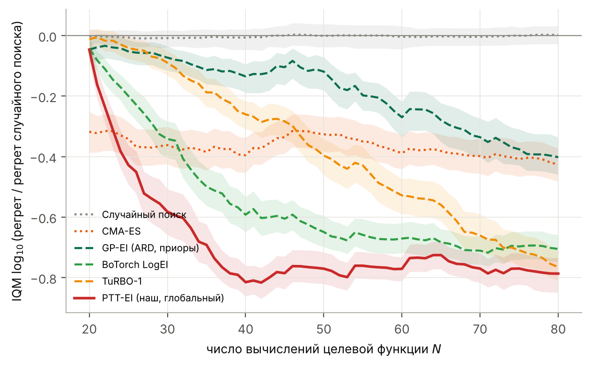
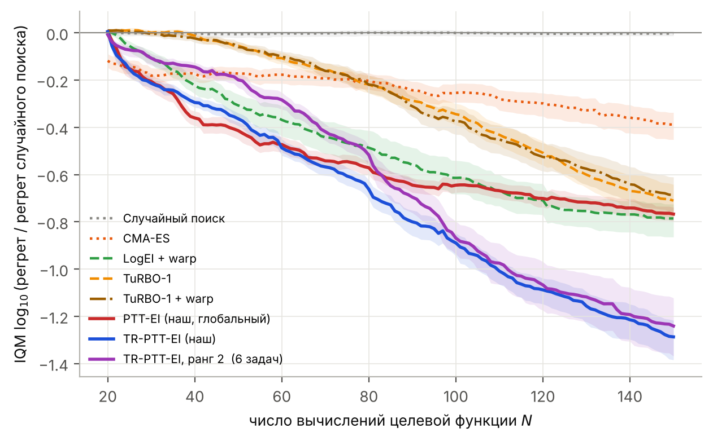

# ptt-bo — вероятностный тензорный поезд как суррогат для байесовской оптимизации

| | |
|---|---|
| **Тема** | Вероятностный тензорный поезд (PTT) как суррогатная модель для байесовской оптимизации |
| **Тип работы** | Научная студия (НИР) |
| **Автор** | Артём Хапилов |
| **Научный руководитель** | Глеб Рыжаков |
| **Статья (черновик)** | [`paper/main.pdf`](paper/main.pdf) |
| **Доклад (1 слайд, 1.5 мин)** | [`slides/slide.pdf`](slides/slide.pdf) (Beamer), [`slides/slide.pptx`](slides/slide.pptx); расширенная версия на 4 слайда — [`slides/extended/`](slides/extended) |

## Аннотация

Байесовская оптимизация (BO) ищет минимум дорогой функции-чёрного ящика за малое число вычислений, строя
вероятностную суррогатную модель. Стандартный суррогат — гауссовский процесс (GP): $O(n^3)$ по числу
наблюдений, а в размерностях $d \ge 10$ ему нужны специальные приоры или локальные стратегии. Мы заменяем GP
на **функциональный тензорный поезд со случайными ядрами** (PTT): ANOVA-приор, MAP-обучение и аппроксимация
Лапласа дают прогноз и неопределённость за время, линейное по $n$. В базовом эксперименте PTT-EI лучше
GP-EI, BoTorch LogEI, TuRBO-1 и CMA-ES на малых бюджетах, но затем застревает; локальная версия в
доверительной области (**TR-PTT**) это исправляет и на отложенных задачах (d = 10–20) значимо
превосходит TuRBO-1.

## Постановка задачи (кратко)

Дана функция $f:[0,1]^d\to\mathbb R$ и бюджет $N$ вычислений. Нужно выбрать точки $\mathbf x_1,\dots,\mathbf x_N$
так, чтобы минимизировать **простой регрет** $r_N=\min_{i\le N} f(\mathbf x_i)-f^{\ast}$ (внешний критерий).

Суррогат: $g(\mathbf x;\mathbf W)=\mathbf G_1(x_1)\cdots\mathbf G_d(x_d)$, где
$\mathbf G_k(x)=\sum_j \mathbf W_k[:,j,:]\,\phi_j(x)$ — матрицы-функции в базисе Фурье.
Внутренний критерий — MAP:
$\hat{\mathbf W}=\arg\min_{\mathbf W}\ \tfrac{\beta}{2}\sum_i \bigl(y_i-g(\mathbf x_i;\mathbf W)\bigr)^2+\tfrac12\sum_k\|\mathbf W_k-\mathbf W_k^0\|^2_{\mathbf V_k^{-1}}$;
неопределённость — аппроксимация Лапласа; следующая точка $\mathbf x_{t+1}=\arg\max \mathrm{EI}_t(\mathbf x)$.

Сравнение методов: $\mathfrak a^{\ast}=\arg\min_{\mathfrak a} S_N(\mathfrak a)$, где $S_N$ — межквартильное среднее
$\log_{10}(r_N / r_N^{\text{random}})$ по задачам и сидам. Полная постановка и таблица обозначений
(с именами в коде) — в разделе 2 [статьи](paper/main.pdf).

## Базовый эксперимент: сравнение с другими методами (E9)

11 тестовых функций (d = 6–12: Rosenbrock, Dixon-Price, Powell, Zakharov, Styblinski–Tang, Hartmann6,
а также их повороты и перестановки), бюджет 100 вычислений, 20 начальных точек Sobol, 10 сидов.



| метод | $S_N$ после 40 вычислений | после 100 вычислений |
|---|---|---|
| **PTT-EI (наш)** | **−0.82** [−0.87, −0.77] | −0.86 [−0.92, −0.81] |
| BoTorch LogEI | −0.59 | −0.80 |
| TuRBO-1 | −0.26 | **−0.98** [−1.05, −0.91] |
| аддитивный GP-EI | −0.25 | −0.61 |
| GP-EI (ARD, приоры длин) | −0.14 | −0.56 |
| CMA-ES | −0.40 | −0.49 |
| случайный поиск | 0.00 | 0.00 |

$S_N$: 0 — уровень случайного поиска, −1 — регрет в 10 раз меньше; в скобках 95% бутстреп-интервал.

**Вывод.** На малом бюджете PTT-EI лучше всех, но после ~40 вычислений перестаёт улучшаться, и TuRBO-1
выходит вперёд. Выигрыш PTT не связан с TT-рангом целевой функции (повороты делают ранг 21 вместо 3, а
результат почти не меняется); решает ANOVA-приор (с нулевым приором регрет в 2–4 раза хуже).

## Улучшение: TR-PTT и проверка на отложенных задачах (E13, E14)

TR-PTT обучает PTT локально в доверительной области вокруг лучшей точки (правила TuRBO-1). Проверка — на 9
задачах, не использованных при разработке (Levy, Ackley, Griewank, Michalewicz, Rastrigin при $d=10$;
Rosenbrock, Dixon-Price, Levy при $d=20$), по протоколу, записанному до запуска.



| гипотеза | результат (90 пар задача×сид) |
|---|---|
| H1: TR-PTT лучше TuRBO-1 в конце бюджета | 75:15, $p=2\cdot10^{-10}$ |
| H2: TR-PTT лучше TuRBO-1 с warp-преобразованием | 71:19, $p=2\cdot10^{-9}$ |
| H3: TR-PTT лучше TuRBO-1 после 40 вычислений | 81:9, $p=2\cdot10^{-14}$ |

Итог в конце бюджета: TR-PTT $S_N=-1.39$, LogEI + warp −0.82, TuRBO-1 −0.80.
Ограничения: синтетические функции, $d\le 20$, $N\le 200$; при $d=10$ TR-PTT в 1.7–3.6 раза дороже TuRBO-1 по времени.

Полный список экспериментов E1–E14 с целями, скриптами и выходами — [`docs/experiments.md`](docs/experiments.md).

## Структура репозитория

```
pttbo/            библиотека
  tt.py           функциональный TT, базисы Фурье / one-hot, точные моменты прогноза
  infer.py        MAP (L-BFGS), аппроксимации Лапласа, VB, ансамбли, Gibbs
  gp.py           GP-бейзлайны: ARD, с приорами длин, аддитивный, Hamming
  bo.py           циклы BO, TR-PTT, warp выхода, CMA-ES, PROTES (порт на numpy)
  bo_botorch.py   бейзлайны BoTorch: LogEI, qLogNEI, TuRBO-1
  functions.py    тестовые функции, повороты и перестановки
experiments/      e1 … e14, рисунки и статистика (stats_bo.py: IQM, бутстреп, Уилкоксон)
run_all.py        запуск всех экспериментов параллельно, с докачкой
results/          сводные таблицы (CSV/JSON); raw_runs.zip — все отдельные прогоны (3276 JSON)
figures/          рисунки
paper/            черновик статьи (LaTeX + PDF, references.bib)
slides/           доклад на один слайд (Beamer + PDF, PPTX); extended/ — версия на 4 слайда
docs/             план и журнал экспериментов
```

## Воспроизведение

```bash
conda env create -f environment.yml
conda activate ttgp
pip install botorch                          # только для бейзлайнов BoTorch (E9, E11b, E13, E14)
python run_all.py --check                    # проверка окружения, ~1 мин
python run_all.py --workers 8 --only e9      # базовый эксперимент
python run_all.py --workers 8 --only new3    # E14 + шум
```

Все прогоны используют фиксированные сиды и один поток BLAS. Чтобы перерисовать рисунки без пересчёта,
распакуйте `results/raw_runs.zip` в `results/` и выполните `python run_all.py --plots`.
Статья и слайды собираются XeLaTeX: `cd paper && latexmk -xelatex main.tex`, `cd slides && latexmk -xelatex slide.tex`.

## Литература

33 источника, проверенных по arXiv/DOI, — в [`paper/references.bib`](paper/references.bib).
Ключевые: Jones et al. 1998 (EGO), Snoek et al. 2012, Eriksson et al. 2019 (TuRBO), Balandat et al. 2020 (BoTorch),
Ament et al. 2023 (LogEI), Hvarfner et al. 2024, Oseledets 2011 (TT), Ryzhakov & Oseledets 2023,
Batsheva et al. 2023 (PROTES), Sozykin et al. 2026.

## Лицензия

MIT — см. [`LICENSE`](LICENSE).
